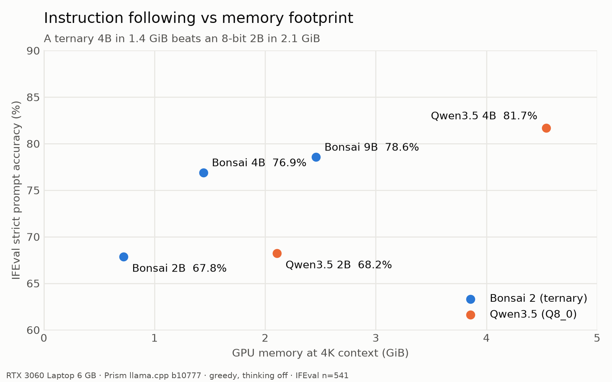
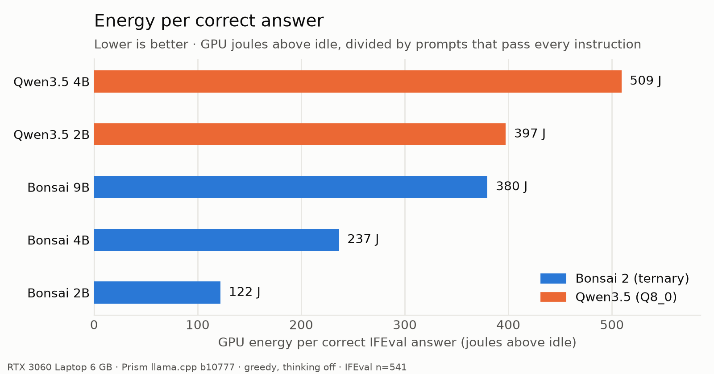

# Bonsai 2 vs Qwen3.5 on a 6 GB laptop GPU

Reproducible measurements of PrismML's ternary **Bonsai 2** models against their **Qwen3.5** base:
memory, speed, energy per correct answer, fidelity to the BF16 base, tool calling and instruction
following. Everything runs on one RTX 3060 Laptop GPU (6 GB), one model at a time.

## Results (2026-10-17)
Full tables: [`results/SUMMARY.md`](results/SUMMARY.md). Per-item outputs and manifests are under `results/<model>/`.

| | Bonsai 2B | Qwen3.5 2B Q8_0 | Bonsai 4B | Qwen3.5 4B Q8_0 | Bonsai 9B |
|---|---|---|---|---|---|
| GGUF size | 0.52 GB | 2.01 GB | 1.15 GB | 4.48 GB | 2.42 GB |
| VRAM at 4K context | 738 MiB | 2,158 MiB | 1,476 MiB | 4,648 MiB | 2,518 MiB |
| Max context in 6 GB (f16 KV) | 262K | 262K | 128K | 32K | 32K |
| Generation tok/s (cool start / sustained) | 307 / 271 | 131 / 122 | 160 / 143 | 61 / 58 | 95 / 83 |
| BFCL simple / multiple | 78.3 / 81.0 | 78.0 / 85.5 | 90.8 / 91.5 | 89.8 / 93.5 | 92.0 / 92.0 |
| BFCL irrelevance (restraint) | 85.4 | 73.8 | 83.3 | 89.6 | 79.6 |
| IFEval strict prompt / instr | 67.8 / 75.8 | 68.2 / 76.6 | 76.9 / 83.2 | 81.7 / 87.2 | 78.6 / 84.9 |
| IFEval mean output tokens | 285 | 453 | 327 | 329 | 328 |
| IFEval truncated / loop rate | 4.4 / 7.4 % | 10.4 / 12.0 % | 3.3 / 3.7 % | 2.6 / 2.4 % | 2.2 / 2.6 % |
| J per correct IFEval answer | 122 | 397 | 237 | 509 | 380 |
| wikitext PPL (BF16 base) | 21.8 (10.9) | 11.0 (10.9) | 15.8 (8.6) | 8.6 (8.6) | 14.4 (no ref) |
| KLD vs BF16 / same top-1 | 0.568 / 66 % | 0.001 / 98 % | 0.518 / 71 % | 0.001 / 99 % | n/a |




**Findings**
1. **Context, not weights, is the memory bill.** Bonsai 2B's weights are 483 MiB; its f16 KV cache at
   262K is 3,072 MiB. The often-quoted "~4 GB VRAM" is the default 262K context. q8_0 KV halves it.
2. **At equal memory, ternary-bigger beats 8-bit-smaller.** Bonsai 4B (1.4 GiB) beats Qwen3.5 2B Q8_0
   (2.1 GiB) by +8.7 IFEval points and +12.8 BFCL-simple points, and generates faster.
3. **At equal parameter count, ternary costs quality.** Bonsai 4B is 4.8 IFEval points and 6.3
   restraint points below Qwen3.5 4B Q8_0, in exchange for 3.1× less memory, 2.6× the speed and
   2.1× less energy per correct answer.
4. **Perplexity and KL divergence are the wrong lens for these models.** Bonsai's wikitext perplexity
   is ~2× the base and its top-1 token agrees only 66–71 % of the time, yet task scores land within
   0–5 points. These models are post-trained, not just compressed.
5. **The "fewer tokens" claim holds at 2B only.** Bonsai 2B writes 37 % fewer tokens than Qwen 2B and
   truncates or loops about half as often. At 4B both write ~328 tokens.
6. **Bonsai 9B is the least restrained tool caller** (79.6 % irrelevance vs 83–90 % elsewhere),
   consistent with reports of unrequested actions.
7. **Laptop thermals move energy and speed, not accuracy.** Reruns reproduced every accuracy number
   exactly. A throttled run used ~28 % less energy per item than an unthrottled one, so every
   experiment now starts from ≤ 60 °C and clocks and temperature are logged.

**Caveats:** single hardware platform; thinking off (vendor numbers use thinking); Qwen at Q8_0
(Q4_K_M would narrow the size and speed gaps); no 9B Qwen or BF16 reference fits this GPU; BFCL
scored with a re-implemented AST checker (see Deviations); Bonsai 4B's E6 energy uses an estimated
idle baseline (that run was interrupted; see its `_recovered` manifest).

## Setup
- Runtime for **all** models: PrismML llama.cpp fork `prism-b10777-e3de715` (CUDA 12.8 build), in
  `~/.local/bonsai2` with the CUDA 12 runtime libs in `~/.local/bonsai2/cuda12`. Stock llama.cpp and
  Ollama can't load the PQ2_0 packing, so using the fork for Qwen too keeps the comparison
  like-for-like.
- Python 3.12 venv: `uv venv --python 3.12 .venv && uv pip install --python .venv requests pyarrow langdetect "nltk==3.8.1" immutabledict absl-py`
- IFEval scoring uses Google's official checkers, vendored in `third_party/instruction_following_eval` (Apache-2.0).

## Run
```bash
./run.sh bonsai2-2b                       # all experiments, then delete the model
./run.sh bonsai2-2b --exp e1,e2 --keep    # a subset, keep the GGUF
./run.sh ref qwen35-2b-bf16               # BF16 logits for E5 KL divergence (refs/2b.kld)
./run.sh qwen35-2b --limit 5              # smoke test on 5 items per dataset
```
Each run:
1. Refuses to start if any other process is using the GPU, and measures idle power for 20 s.
2. Downloads the GGUF and checks its sha256.
3. Runs the experiments with a 100 ms `nvidia-smi` power sampler on.
4. Kills only the processes it started, checks that VRAM is back to baseline, deletes the model
   (unless `--keep`), and writes `results/<model>/manifests/<timestamp>.json`.

## Experiments
| id | what | how |
|---|---|---|
| E1 | VRAM vs context | llama-server at ctx 4K/32K/128K/262K × KV f16/q8_0; model / KV / recurrent-state / compute buffers parsed from the server log |
| E2 | speed | llama-bench, 3 reps: pp512/4096/16384; tg128 at depth 0/4K/16K/32K |
| E3 | energy | idle-subtracted GPU joules per item, per correct answer and per output token, for E6 and IFEval |
| E5 | fidelity | llama-perplexity on wikitext-2-raw test (20 × 1024-token chunks): PPL, KL divergence and top-1 agreement vs Qwen3.5 BF16 logits |
| E6 | tool calling | BFCL v3 simple (400), multiple (200), irrelevance (240) through `/v1/chat/completions` with `tools` |
| IFEval | instruction following | all 541 prompts, max 2048 tokens; strict/loose accuracy at prompt and instruction level, plus truncation and loop rate |

Common decoding: greedy (temperature 0), seed 42, thinking off (`--reasoning off` and
`enable_thinking: false`), one server slot, flash attention on, eval context 8192.

## Deviations from the official harnesses
- **BFCL**: our own runner. The AST checker re-implements BFCL's rules: function name, required
  params, no unknown params, type check (int accepted for float), value in the allowed list, and
  BFCL's string normalisation. A response with anything other than exactly one call fails
  simple/multiple. Irrelevance passes only when no tool is called. Names containing dots are
  sanitised to `_` for the tools API and mapped back before scoring.
- **IFEval**: generation through our runner (to get per-item timing and energy); scoring uses the
  official code unchanged.
- Thinking is off for every model, so scores are not comparable to vendor numbers that use thinking.

## Layout
`run.py` orchestrator · `lib/` (paths, GPU sampler, server control) · `exp/` (one module per
experiment) · `config/models.json` · `results/` (committed summaries; raw power and logs are git-ignored).
